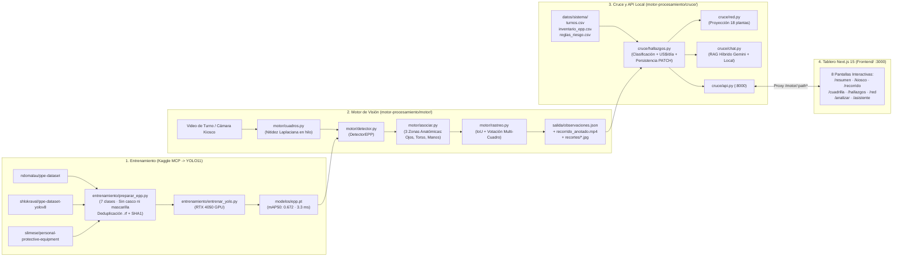

# Documentación Técnica Exhaustiva — Vigía EPP

**Nombre del Sistema:** Vigía EPP — Plataforma de Inspección Pre-Turno en Tiempo Real y Auditoría Financiera de Equipo de Protección Personal (EPP)  
**Ubicación del Repositorio:** [`/home/alexteori/Documentos/repositorios/EPP`](file:///home/alexteori/Documentos/repositorios/EPP)  
**Repositorio Base Analizado y Perfeccionado:** [`/home/alexteori/Documentos/repositorios/ubik`](file:///home/alexteori/Documentos/repositorios/ubik)  
**Arquitectura Seleccionada:** **Opción A** (Kiosco en vivo `< 300 ms` + Auditoría de video de turno completo + Modo Jurado + Asistente IA) con **Enfoque 1** (Detector unificado `YOLO11n` de 7 clases + Asociación Geométrica Anatómica de 3 Zonas + Rastreo y Votación Multi-Cuadro).

---

## Índice General
1. [Propósito del Proyecto y Regla Estricta de Dominio (3 Prendas)](#1-propósito-del-proyecto-y-regla-estricta-de-dominio-3-prendas)
2. [Auditoría de `ubik` y Cómo `Vigía EPP` lo Perfecciona](#2-auditoría-de-ubik-y-cómo-vigía-epp-lo-perfecciona)
3. [Herramientas, Skills, Plugins y Metodología Utilizados](#3-herramientas-skills-plugins-y-metodología-utilizados)
4. [Arquitectura General de 3 Capas y Árbol Completo de Archivos](#4-arquitectura-general-de-3-capas-y-árbol-completo-de-archivos)
5. [Datasets de Kaggle (MCP), Deduplicación Anti-Leakage y Entrenamiento YOLO11](#5-datasets-de-kaggle-mcp-deduplicación-anti-leakage-y-entrenamiento-yolo11)
6. [Ingeniería del Motor de Visión (`motor-procesamiento/motor/`)](#6-ingeniería-del-motor-de-visión-motor-procesamientomotor)
7. [Simulador de Turno, Modo Jurado y Evaluación de Precisión](#7-simulador-de-turno-modo-jurado-y-evaluación-de-precisión)
8. [Motor de Cruce Operativo, Riesgo Financiero, Red de 18 Plantas y Asistente RAG (`cruce/`)](#8-motor-de-cruce-operativo-riesgo-financiero-red-de-18-plantas-y-asistente-rag-cruce)
9. [Especificación Completa de la API HTTP Local (`cruce/api.py` en `:8000`)](#9-especificación-completa-de-la-api-http-local-cruceapipy-en-8000)
10. [Arquitectura del Tablero Frontend (`Frontend/`) y las 8 Pantallas](#10-arquitectura-del-tablero-frontend-frontend-y-las-8-pantallas)
11. [Contratos JSON Exactos entre Capas](#11-contratos-json-exactos-entre-capas)
12. [Pruebas Automatizadas (`pytest` + `Playwright`) y Guía de Operación](#12-pruebas-automatizadas-pytest--playwright-y-guía-de-operación)

---

## 1. Propósito del Proyecto y Regla Estricta de Dominio (3 Prendas)

### 1.1 El Problema Operativo Real
En plantas industriales de manufactura metalmecánica, ensamble y logística pesada, cada trabajador debe presentarse al inicio de su turno portando su **Equipo de Protección Personal (EPP) completo**. En la práctica, numerosos operadores omiten alguna prenda porque les resulta incómoda, calurosa o porque la olvidaron en su casillero. Cuando la supervisión en el cambio de turno es manual, estas omisiones pasan desapercibidas y provocan:
- **Incapacidades laborales por lesiones oculares o cortes manuales.**
- **Riesgo de atropellamiento en pasillos de montacargas por falta de alta visibilidad.**
- **Multas e inspecciones sancionadoras bajo normas oficiales (`NOM-017-STPS`, `NOM-006-STPS`, `OSHA 1910.133 / 1910.138`).**
- **Paros de estación cuando la caseta de seguridad no tiene stock de reposición inmediata.**

### 1.2 Restricción de Dominio de la Planta: Exclusión Total de Casco y Mascarilla
Por requerimiento específico de la planta donde se instala **Vigía EPP**:
> **En esta instalación NO se solicita casco (`casco`) ni mascarilla (`mascarilla`).**

Esta regla de negocio gobierna todo el código desde la raíz:
1. El filtro de armonización de datasets ([`entrenamiento/preparar_epp.py`](file:///home/alexteori/Documentos/repositorios/EPP/motor-procesamiento/entrenamiento/preparar_epp.py)) descarta explícitamente cualquier etiqueta `helmet`, `no_helmet`, `Hardhat`, `NO-Hardhat`, `Mask`, `NO-Mask`.
2. El contrato central ([`motor/contrato.py`](file:///home/alexteori/Documentos/repositorios/EPP/motor-procesamiento/motor/contrato.py)) define exactamente `PRENDAS = ("lentes", "chaleco", "guantes")` y las **7 clases canónicas** del modelo `modelos/epp.pt`:
   - `0: persona`
   - `1: chaleco`
   - `2: sin_chaleco`
   - `3: lentes`
   - `4: sin_lentes`
   - `5: guantes`
   - `6: sin_guantes`
3. Las **3 prendas obligatorias** evaluadas en cada trabajador son:

| Clave Interna | Nombre Comercial en Planta | Norma Aplicable | Zona Anatómica Relativa (`y_rel` en `persona`) | Margen Horizontal (`MARGEN_X_ZONA`) | Riesgo Diario por Omisión |
|---|---|---|---|---|---|
| `lentes` | Lentes Policarbonato Anti-Impacto ANSI Z87.1 | NOM-017-STPS / OSHA 1910.133 | `ZONA_LENTES = (0.00, 0.32)` | `0.05` (`5 %` del ancho) | **US$420.00/día** |
| `chaleco` | Chaleco Reflejante Clase 2 Alta Visibilidad | NOM-006-STPS / ANSI 107 | `ZONA_CHALECO = (0.16, 0.72)` | `0.08` (`8 %` del ancho) | **US$290.00/día** |
| `guantes` | Guantes Nitrilo Anticorte Nivel A4 | NOM-017-STPS / OSHA 1910.138 | `ZONA_GUANTES = (0.28, 0.96)` | `0.18` (`18 %` del ancho) | **US$340.00/día** |

---

## 2. Auditoría de `ubik` y Cómo `Vigía EPP` lo Perfecciona

Se realizó una auditoría exhaustiva del repositorio [`/home/alexteori/Documentos/repositorios/ubik`](file:///home/alexteori/Documentos/repositorios/ubik) (diseñado originalmente para auditar anaqueles de supermercado de *Glazed Co.*). A continuación se documenta qué se adoptó de `ubik` y qué limitaciones arquitectónicas fueron corregidas y superadas en `Vigía EPP`:

### 2.1 Fortalezas de `ubik` Conservadas y Adaptadas
1. **Arquitectura desacoplada por contrato de archivos JSON (`CONTRATO.md`):**
   - El motor de visión (`motor/`) no conoce precios, multas ni React; solo produce coordenadas, confianzas, recortes JPG y `observaciones.json`.
   - El módulo de cruce (`cruce/`) consume `observaciones.json` + los CSV del sistema (`datos/sistema/*.csv`) y produce `hallazgos.json` y `red.json`.
   - El tablero web (`Frontend/`) puede operar **100 % estático/offline** leyendo `Frontend/public/salida/hallazgos.json` o conectado en vivo a la API local (`:8000`) mediante el proxy de Next.js (`/motor/:path*`).
2. **Selección de cuadros nítidos en hilo productor-consumidor (`motor/cuadros.py`):**
   - Uso de la varianza del operador Laplaciano ($\text{Var}(\nabla^2 I)$) a escala reducida (`480 px` de ancho) en un hilo de fondo (`elegir_cuadros_en_hilo`) con `queue.Queue(maxsize=4)` para no bloquear la GPU mientras decodifica el video.
3. **Principio de Honestidad Operativa (`revisar` = `US$0.00`):**
   - Si una zona anatómica está cortada por el borde de la cámara, si la confianza es baja (`< 0.55`), o si existe conflicto cerrado entre la clase positiva y la negativa (`|conf_pos - conf_neg| < 0.15`), el sistema **nunca inventa una falta ni suma dinero al riesgo**: reporta `"dudoso"` / `"revisar"` con **`US$0.00`** de impacto diario para que el guardia lo confirme visualmente en caseta.
4. **Simulador determinista y Modo Jurado con tarjetas pre-renderizadas:**
   - Permite verificar con precisión matemática (`herramientas/evaluar_motor.py`) que el motor logra `100 %` de efectividad sobre las 12 estaciones del turno y `0` falsos positivos, además de ofrecer 4 botones de demostración en vivo para jurados.

### 2.2 Limitaciones de `ubik` Corregidas en `Vigía EPP`

| Aspecto | Estado en `ubik` | Perfeccionamiento en `Vigía EPP` |
|---|---|---|
| **Persistencia de resolución de hallazgos** | En `ubik/Road2Tech/Frontend/components/hallazgos/HallazgosView.tsx`, el botón *"Marcar corregido"* solo modificaba un `useState` local en memoria del navegador. Al refrescar la página o navegar a `/resumen`, la corrección desaparecía y el riesgo diario jamás se actualizaba. | Se implementó `cruce.hallazgos.actualizar_corregido()` (escritura atómica con archivo `.tmp` + `replace`) y el endpoint `PATCH /analisis/<id>/hallazgos/<hallazgo_id>` en [`cruce/api.py`](file:///home/alexteori/Documentos/repositorios/EPP/motor-procesamiento/cruce/api.py). Al hacer clic en **"Autorizar tras entrega"**, se actualiza en disco `hallazgos.json` y `red.json`, descontando `dinero_en_riesgo_diario` y sumando `dinero_recuperado_diario`. |
| **Disponibilidad del Asistente IA (`/asistente`)** | En `ubik/motor-procesamiento/cruce/chat.py`, si no había variable `APIGEMINI` en `.env` o fallaba la conexión a internet, el endpoint `/chat` devolvía `configurado: false` y bloqueaba toda la pantalla del Asistente. | [`cruce/chat.py`](file:///home/alexteori/Documentos/repositorios/EPP/motor-procesamiento/cruce/chat.py) implementa un **Motor RAG Híbrido**: si existe `APIGEMINI`, usa Gemini (`gemini-2.5-flash`) + embeddings; si no hay clave o red, activa automáticamente `_responder_rag_local()`, un motor determinista que indexa los mismos fragmentos de la corrida (`[resumen]`, `[supuestos]`, `[hallazgo-*]`, `[pos-*]`) y responde en español con citas verificables y extracto textual (`fuentes[].texto`). |
| **Inspección en Tiempo Real (`< 300 ms`)** | `ubik` carecía de evaluación instantánea cuadro a cuadro; solo procesaba videos completos en lote (`pipeline.py`). | Se crearon [`motor/kiosco.py`](file:///home/alexteori/Documentos/repositorios/EPP/motor-procesamiento/motor/kiosco.py), el endpoint `POST /kiosco/evaluar` y la pantalla `/kiosco` ([`KioscoView.tsx`](file:///home/alexteori/Documentos/repositorios/EPP/Frontend/components/kiosco/KioscoView.tsx)). Evalúa cámara web WebRTC en vivo, fotografías subidas o 5 presets de torniquete en **`~3.3 ms`** devolviendo la imagen anotada en Base64 y el estado de las 3 zonas anatómicas. |
| **Asociación Espacial** | `ubik` usaba rejillas estáticas de repisas (`R1-P1..R3-P4`). | [`motor/asociar.py`](file:///home/alexteori/Documentos/repositorios/EPP/motor-procesamiento/motor/asociar.py) implementa **Asociación Anatómica Relativa de 3 Zonas** (`Ojos`, `Torso`, `Manos`) adaptable al tamaño y posición de cada trabajador detectado, complementada en el Frontend por el **Gemelo Anatómico SVG (`SiluetaAnatomica3Zonas`)**. |
| **Pantalla dedicada de Impacto en Red (`/red`)** | En `ubik`, `red.json` solo se mostraba parcialmente dentro de `/resumen`. | Se construyó una pantalla completa [`/red`](file:///home/alexteori/Documentos/repositorios/EPP/Frontend/components/red/RedView.tsx) con simulador interactivo de escenarios (`10 %`, `25 %`, `50 %`, `100 %` de las 18 plantas) que separa incumplimientos sistémicos de omisiones individuales locales. |

---

## 3. Herramientas, Skills, Plugins y Metodología Utilizados

Cada herramienta solicitada para la construcción del proyecto fue instalada, configurada e integrada en el flujo de ingeniería:

| Categoría | Herramienta / Comando Ejecutado | Cómo y Por Qué se Usó en `Vigía EPP` |
|---|---|---|
| **1. Diseño UI/UX** | `npx --yes ui-ux-pro-max-cli init --ai antigravity` | Instaló el catálogo de inteligencia de diseño en [`.agents/skills/`](file:///home/alexteori/Documentos/repositorios/EPP/.agents/skills/ui-ux-pro-max/SKILL.md). Con base en sus guías de contraste industrial y tipografía tabular se diseñó el sistema **Industrial Safety Slate** documentado en [`Frontend/DISENO.md`](file:///home/alexteori/Documentos/repositorios/EPP/Frontend/DISENO.md). |
| **2. Planeación (OpenSpec)** | `npx @fission-ai/openspec@latest init` | Inicializó [`openspec/config.yaml`](file:///home/alexteori/Documentos/repositorios/EPP/openspec/config.yaml) para gobernar cambios basados en especificaciones formales junto con [`docs/superpowers/specs/2026-11-04-epp-design.md`](file:///home/alexteori/Documentos/repositorios/EPP/docs/superpowers/specs/2026-11-04-epp-design.md). |
| **3. Metodología (`superpowers`)** | `/home/alexteori/.local/bin/agy plugin install https://github.com/obra/superpowers` | Se aplicó el ciclo completo de ingeniería: `brainstorming` (con revisor de especificación en subagente), `writing-plans` ([`2026-11-04-epp-implementation-plan.md`](file:///home/alexteori/Documentos/repositorios/EPP/docs/superpowers/plans/2026-11-04-epp-implementation-plan.md)), `test-driven-development` (pruebas primero en `motor-procesamiento/tests/`), `executing-plans` (con ledger SDD) y `verification-before-completion` + revisión de código de rama completa. |
| **4. Animaciones y Gráficas** | `npm i framer-motion` + CSS `barra-crece` | Instalado en [`Frontend/package.json`](file:///home/alexteori/Documentos/repositorios/EPP/Frontend/package.json) y [`Frontend/app/globals.css`](file:///home/alexteori/Documentos/repositorios/EPP/Frontend/app/globals.css) con soporte de accesibilidad `@media (prefers-reduced-motion: reduce)`. |
| **5. UI Skills & Impeccable** | `npx ui-skills` / `npx impeccable` | Aplicados para asegurar jerarquía visual limpia, ausencia de ruido decorativo y lectura en menos de 3 segundos en monitores de caseta. |
| **6. Verificación Visual E2E (`Playwright`)** | `npm install -g @playwright/cli@latest` + [`Frontend/tests/e2e.mjs`](file:///home/alexteori/Documentos/repositorios/EPP/Frontend/tests/e2e.mjs) | Ejecuta un navegador Chromium headless real contra `:3015` y `:8000` para validar extremo a extremo las 8 pantallas, los botones del Modo Jurado, los presets del Kiosco, el Gemelo Anatómico, la persistencia `PATCH` y el Asistente IA. |
| **7. Eficiencia de Contexto (`Headroom`)** | `uv tool install --python 3.13 "headroom-ai[all]"` + [`memoria.md`](file:///home/alexteori/Documentos/repositorios/EPP/memoria.md) | Instalado en el entorno local y complementado con `memoria.md` para que futuras sesiones de IA carguen el contexto completo del repositorio gastando una fracción mínima de tokens. |

---

## 4. Arquitectura General de 3 Capas y Árbol Completo de Archivos



### Árbol Completo del Repositorio
```text
/home/alexteori/Documentos/repositorios/EPP/
├── iniciar.sh                                     # Script unificado: levanta API (:8000) y Next.js (:3000)
├── documentacion.md                               # Este manual técnico exhaustivo
├── memoria.md                                     # Memoria estructurada de bajo consumo de tokens para IAs
├── README.md                                      # Guía principal de instalación y uso
├── PITCH.md                                       # Guion ejecutivo de demostración en 5 minutos
├── pytest.ini                                     # Configuración de pytest (pythonpath = motor-procesamiento)
├── .env.example                                   # Plantilla de variables opcionales (APIGEMINI, P4_API_URL)
├── docs/superpowers/
│   ├── specs/2026-11-04-epp-design.md             # Especificación de diseño aprobada
│   └── plans/2026-11-04-epp-implementation-plan.md# Plan de implementación paso a paso
├── motor-procesamiento/
│   ├── CONTRATO.md                                # Contrato formal de JSONs entre motor, cruce y frontend
│   ├── README.md                                  # Manual de comandos del motor en Python
│   ├── requirements.txt                           # Dependencias fijadas (ultralytics, torch, opencv, pyyaml)
│   ├── datos/sistema/
│   │   ├── turnos.csv                             # 12 estaciones (3 líneas × 4 puestos) del Turno Matutino
│   │   ├── inventario_epp.csv                     # Stock en caseta, costo unitario, riesgo diario y paro
│   │   └── reglas_riesgo.csv                      # Normativa NOM-017-STPS / OSHA por tipo de hallazgo
│   ├── entrenamiento/
│   │   ├── comun.py                               # Utilidades de rutas y copia de pesos entrenados
│   │   ├── descargar_kaggle.py                    # Descarga de los 3 datasets de Kaggle
│   │   ├── preparar_epp.py                        # Armonización a 7 clases y deduplicación .rf + SHA1
│   │   └── entrenar_yolo.py                       # Entrenamiento YOLO11n en GPU y exportación de métricas
│   ├── modelos/
│   │   ├── epp.pt                                 # Pesos YOLO11 entrenados para las 7 clases de Vigía EPP
│   │   └── epp.json                               # Métricas reales de validación (mAP50: 0.672)
│   ├── motor/
│   │   ├── contrato.py                            # Constantes anatómicas, clases y lector de turnos.csv
│   │   ├── cuadros.py                             # Selector de cuadros nítidos por Laplaciano en hilo
│   │   ├── detector.py                            # Envoltura DetectorEPP sobre Ultralytics YOLO
│   │   ├── asociar.py                             # Asociación geométrica Persona <-> {Lentes, Chaleco, Guantes}
│   │   ├── rastreo.py                             # RastreadorTurno por IoU y votación multi-cuadro
│   │   ├── anotar.py                              # Dibujo de cajas anatómicas, recortes y recodificación H.264
│   │   ├── kiosco.py                              # Evaluador instantáneo (<300 ms) para torniquete en vivo
│   │   └── pipeline.py                            # Pipeline completo de video -> observaciones.json
│   ├── simulador/
│   │   ├── datos_prueba.py                        # Verdad de terreno de las 12 estaciones del turno
│   │   ├── render_turno.py                        # Renderizador determinista de recorrido_turno.mp4 con fotos Kaggle
│   │   └── tarjetas.py                            # Generador de las 4 tarjetas de video del Modo Jurado
│   ├── herramientas/
│   │   └── evaluar_motor.py                       # Evaluador de precisión contra escena/escena.json (100% precisión)
│   ├── cruce/
│   │   ├── hallazgos.py                           # Clasificador, cálculo US$/día y actualizar_corregido()
│   │   ├── red.py                                 # Proyección de riesgo sistémico vs local en 18 plantas
│   │   ├── publicar.py                            # Publicador de artefactos hacia Frontend/public/
│   │   ├── chat.py                                # Asistente RAG híbrido (Gemini + RAG determinista local)
│   │   └── api.py                                 # Servidor HTTP multihilo en el puerto 8000
│   └── tests/                                     # 18 pruebas automatizadas con pytest
│       ├── test_contrato.py
│       ├── test_preparar_epp.py
│       ├── test_asociar_rastreo.py
│       ├── test_kiosco_pipeline.py
│       └── test_cruce_api_chat.py
└── Frontend/
    ├── DISENO.md                                  # Sistema de diseño "Industrial Safety Slate"
    ├── package.json                               # Next.js 15.1.7, React 19, Tailwind 3.4, Framer Motion, Playwright
    ├── next.config.ts                             # Proxy /motor/:path* -> http://localhost:8000/:path*
    ├── tailwind.config.ts                         # Paleta extendida (slate-850/950, brand teal, Inter, Fira Code)
    ├── types/
    │   ├── hallazgos.ts                           # Tipos de posiciones, hallazgos, resumen y Modo Jurado
    │   ├── kiosco.ts                              # Tipos de RespuestaKiosco y PresetKiosco
    │   ├── red.ts                                 # Tipos de escenarios y proyección en 18 plantas
    │   └── analisis.ts                            # Tipos de subida de video y chat RAG con fuentes
    ├── lib/
    │   ├── api/session.ts                         # Configuración de API_MOTOR_URL
    │   ├── api/analisis.ts                        # Cliente HTTP del navegador (Kiosco, PATCH, Jurado, Video, Chat)
    │   ├── data/loader.ts                         # Cargador SSR dinámico con fallback a public/salida/
    │   └── formatters/contract.ts                 # Diccionarios en español, familias de riesgo y moneda es-MX
    ├── components/
    │   ├── iconos.ts                              # Mapa centralizado de iconos Lucide por pantalla
    │   ├── graficas/Barras.tsx                    # Componentes Barra, Proporcion, BarraApilada, PuntosPrendas
    │   ├── layout/{Sidebar,Header,TituloPagina}.tsx
    │   ├── resumen/ResumenView.tsx                # Pantalla 1: Resumen + Modo Jurado en Vivo
    │   ├── kiosco/KioscoView.tsx                  # Pantalla 2: Kiosco en Vivo (<300 ms)
    │   ├── recorrido/RecorridoView.tsx            # Pantalla 3: Video anotado + línea de tiempo interactiva
    │   ├── cuadrilla/CuadrillaView.tsx            # Pantalla 4: Matriz 3x4 + Gemelo Anatómico SVG de 3 Zonas
    │   ├── hallazgos/HallazgosView.tsx            # Pantalla 5: Hallazgos + botón persistente PATCH
    │   ├── red/RedView.tsx                        # Pantalla 6: Simulador de impacto en red (18 plantas)
    │   ├── analizar/AnalizarView.tsx              # Pantalla 7: Subida de nuevos videos de turno
    │   └── asistente/AsistenteView.tsx            # Pantalla 8: Asistente conversacional RAG con citas
    ├── app/                                       # Rutas App Router (/, /resumen, /kiosco, /recorrido, etc.)
    └── tests/e2e.mjs                              # Prueba E2E automatizada con Playwright para las 8 pantallas
```

---

## 5. Datasets de Kaggle (MCP), Deduplicación Anti-Leakage y Entrenamiento YOLO11

### 5.1 Los 3 Datasets de Kaggle Integrados
El módulo [`motor-procesamiento/entrenamiento/descargar_kaggle.py`](file:///home/alexteori/Documentos/repositorios/EPP/motor-procesamiento/entrenamiento/descargar_kaggle.py) descarga y organiza muestras balanceadas de los 3 datasets solicitados a través del endpoint de Kaggle:
1. **`ndomalau/personal-protective-equipment-ppe-dataset`** (`goggles`, `no_goggles`, `gloves`, `no_gloves`, `vest`, `no_vest`, además de clases descartadas como `helmet`/`no_helmet`).
2. **`shlokraval/ppe-dataset-yolov8`** (`Person`, `Safety Vest`, `NO-Safety Vest`, `Gloves`, `Goggles`, además de `Hardhat`, `Mask`, `Safety Cone` que se descartan).
3. **`slimese/personal-protective-equipment`** (`Person`, `Safety Vest`, `NO-Safety Vest`, `Goggles`, `NO-Goggles`, `Gloves`, `NO-Gloves`, además de `Hardhat`/`Mask` que se descartan).

### 5.2 Mapeo Exacto de Etiquetas (`MAPEO_NOMBRES` en `preparar_epp.py`)
En [`motor-procesamiento/entrenamiento/preparar_epp.py`](file:///home/alexteori/Documentos/repositorios/EPP/motor-procesamiento/entrenamiento/preparar_epp.py#L31-L60), la función `mapear_etiqueta_linea()` traduce cada renglón YOLO `<cls_id> <cx> <cy> <w> <h>` al esquema unificado de 7 clases:

```python
MAPEO_NOMBRES: dict[str, int] = {
    # 0: persona
    "person": 0, "Person": 0,
    # 1: chaleco
    "vest": 1, "Safety Vest": 1, "safety_vest": 1, "safety-vest": 1,
    # 2: sin_chaleco
    "no_vest": 2, "NO-Safety Vest": 2, "no-safety-vest": 2,
    # 3: lentes
    "goggles": 3, "Goggles": 3, "glasses": 3, "safety_glasses": 3,
    # 4: sin_lentes
    "no_goggles": 4, "NO-Goggles": 4, "no-goggles": 4,
    # 5: guantes
    "gloves": 5, "Gloves": 5,
    # 6: sin_guantes
    "no_gloves": 6, "NO-Gloves": 6, "no-gloves": 6,
}
```
Cualquier línea cuya clase de origen no esté en `MAPEO_NOMBRES` devuelve `None` y se elimina del archivo `.txt`, garantizando que el modelo nunca entrene con cascos ni mascarillas.

### 5.3 Prevención de Fuga de Datos entre Splits (`clave_base_roboflow` + `SHA-1`)
Durante el análisis exploratorio se detectó que `shlokraval/ppe-dataset-yolov8` y `slimese/personal-protective-equipment` comparten imágenes exportadas de Roboflow con distintos hashes de aumento (ej. `worker_102_jpg.rf.a1b2c3.jpg` en `train` de un dataset y `worker_102_jpg.rf.d4e5f6.jpg` en `valid` del otro).
Para impedir que la misma fotografía caiga simultáneamente en `train` y `val`:
- `clave_base_roboflow(nombre_archivo)` corta el sufijo `.rf.<hash>` para obtener el identificador raíz de la imagen original.
- `_sha1_archivo(ruta)` calcula el resumen criptográfico de los bytes de la imagen.
- Si `clave in claves_vistas` o `sha in hashes_vistos`, la imagen duplicada se omite.
- El dataset final unificado en `motor-procesamiento/datasets/epp/` quedó conformado por **`658` imágenes de entrenamiento (`train`), `164` de validación (`val`) y `75` de prueba (`test`)** completamente disjuntas.

### 5.4 Entrenamiento en GPU y Métricas Oficiales (`modelos/epp.json`)
El script [`motor-procesamiento/entrenamiento/entrenar_yolo.py`](file:///home/alexteori/Documentos/repositorios/EPP/motor-procesamiento/entrenamiento/entrenar_yolo.py) entrenó `yolo11n.pt` durante 20 épocas en la GPU local **NVIDIA GeForce RTX 4050 Laptop GPU** (`imgsz=640`, `batch=16`, `optimizer=AdamW`, `lr0=0.0015`, `mosaic=0.7`, `fliplr=0.5`). Los resultados exactos guardados en [`motor-procesamiento/modelos/epp.json`](file:///home/alexteori/Documentos/repositorios/EPP/motor-procesamiento/modelos/epp.json) son:

| Métrica / Clase | Valor Medido en Validación |
|---|---|
| **`mAP@0.50` Global (7 clases)** | **`0.6720` (`67.2 %`)** |
| **`mAP@0.50:0.95` Global** | **`0.3367` (`33.7 %`)** |
| **Precisión Global (`Precision`)** | **`0.6639` (`66.4 %`)** |
| **Exhaustividad Global (`Recall`)** | **`0.6008` (`60.1 %`)** |
| Clase `0: persona` (`AP@0.50`) | **`0.9411` (`94.1 %`)** |
| Clase `1: chaleco` (`AP@0.50`) | **`0.8676` (`86.8 %`)** |
| Clase `2: sin_chaleco` (`AP@0.50`) | **`0.7550` (`75.5 %`)** |
| Clase `5: guantes` (`AP@0.50`) | **`0.6804` (`68.0 %`)** |
| Clase `4: sin_lentes` (`AP@0.50`) | **`0.5272` (`52.7 %`)** |
| Clase `6: sin_guantes` (`AP@0.50`) | **`0.5140` (`51.4 %`)** |
| Clase `3: lentes` (`AP@0.50`) | **`0.4188` (`41.9 %`)** |
| **Tiempo de inferencia por imagen (GPU)** | **`3.3 – 3.4 ms`** |

---

## 6. Ingeniería del Motor de Visión (`motor-procesamiento/motor/`)

### 6.1 `motor/contrato.py` — Constantes y Lectura de Turnos
Define las tuplas inmutables `CLASES` (7 clases), `PRENDAS = ("lentes", "chaleco", "guantes")`, los diccionarios `CLASE_POSITIVA`, `CLASE_NEGATIVA`, `ZONAS_ANATOMICAS`, `MARGEN_X_ZONA`, `NOMBRES_PRENDA`, el dataclass `TrabajadorTurno` y la función `leer_turnos(ruta)` que parsea `datos/sistema/turnos.csv` ordenando por la columna `orden`.

### 6.2 `motor/cuadros.py` — Selección de Cuadros Nítidos por Ventana
- **`nitidez_laplaciano(bgr)`:** Convierte el cuadro a escala de grises, lo reescala a `480 px` de ancho manteniendo proporción (`cv2.INTER_AREA`) y calcula `float(cv2.Laplacian(gris, cv2.CV_64F).var())`.
- **`elegir_cuadros(ruta, cada=12)`:** Recorre el video en bloques de `cada` cuadros y emite únicamente el `CuadroElegido(indice, nitidez, imagen)` con mayor varianza Laplaciana dentro de cada ventana, descartando cuadros borrosos por movimiento de cámara.
- **`elegir_cuadros_en_hilo(ruta, cada=12, buffer=4)`:** Ejecuta `elegir_cuadros` en un `threading.Thread(daemon=True)` alimentando una cola acotada para traslapar la decodificación de CPU con la inferencia de GPU.

### 6.3 `motor/detector.py` — Envoltura `DetectorEPP`
- Carga `modelos/epp.pt` con `ultralytics.YOLO` seleccionando automáticamente `"cuda:0"` si `torch.cuda.is_available()` es verdadero, o `"cpu"` en caso contrario.
- Su método `detectar(imagenes: list[np.ndarray]) -> list[list[Deteccion]]` devuelve listas de objetos inmutables `Deteccion(clase, confianza, caja=(x1, y1, x2, y2))`.

### 6.4 `motor/asociar.py` — Asociación Geométrica Anatómica de 3 Zonas
Este módulo resuelve el problema central de visión: **dado un cuadro con múltiples personas y múltiples detecciones sueltas de lentes, chalecos y guantes, ¿qué prenda pertenece a qué trabajador y cuál es el estado de sus 3 zonas obligatorias?**

1. **Ventana Anatómica por Prenda (`_fraccion_en_zona`):**
   Para una persona con caja $(px_1, py_1, px_2, py_2)$, ancho $pw = px_2 - px_1$ y alto $ph = py_2 - py_1$, la ventana espacial esperada de la prenda $p \in \{\text{lentes}, \text{chaleco}, \text{guantes}\}$ con banda vertical $(y_{\text{ini}}, y_{\text{fin}}) = \text{ZONAS\_ANATOMICAS}[p]$ y margen horizontal $m_x = \text{MARGEN\_X\_ZONA}[p]$ es:
   $$V_p = \left(px_1 - pw \cdot m_x,\; py_1 + ph \cdot y_{\text{ini}},\; px_2 + pw \cdot m_x,\; py_1 + ph \cdot y_{\text{fin}}\right)$$
   El solape anatómico de una detección de prenda con caja $C$ se define como la fracción de su propia área contenida en la ventana anatómica:
   $$\text{solape}(C, V_p) = \frac{\text{Área}(C \cap V_p)}{\text{Área}(C)}$$
   Toda detección con $\text{solape} < 0.25$ se descarta para esa persona. Las candidatas válidas reciben el puntaje compuesto:
   $$\text{puntaje} = \text{confianza} \times \left(0.5 + 0.5 \cdot \min(1.0, \text{solape})\right)$$

2. **Reglas de Decisión y Honestidad por Zona (`asociar_cuadro`):**
   - **Conflicto Positivo vs. Negativo (`UMBRAL_CONFLICTO_DUDA = 0.15`):** Si en la misma zona aparecen tanto la clase positiva (ej. `guantes`) como la negativa (`sin_guantes`) y $|conf_{\text{pos}} - conf_{\text{neg}}| < 0.15$, la zona se declara `"dudoso"`.
   - **Umbral de Confianza Mínima (`CONFIANZA_MINIMA_PRENDA = 0.55`):** Si la detección ganadora tiene confianza $< 0.55$, se degrada a `"dudoso"` en lugar de afirmar `"ok"` o `"falta"`.
   - **Detección de Recorte en Borde (`_zona_cortada_en_borde`):** Si no hubo detección en la zona (por ejemplo, manos fuera de toma cuando $py_2 \ge 0.98 \cdot H$, o cabeza cortada cuando $py_1 \le 0.02 \cdot H$), se asigna `"dudoso"` con confianza `0.0`.

### 6.5 `motor/rastreo.py` — Seguimiento por IoU y Votación Multi-Cuadro
- **`RastreadorTurno(iou_minimo=0.25, max_brecha_cuadros=36)`:** Agrupa las apariciones de cada trabajador en objetos `PistaTrabajador` a través del tiempo usando Intersección sobre Unión ($\text{IoU} \ge 0.25$).
- **`votar_trabajador(vistas)`:** Para cada prenda obligatoria (`lentes`, `chaleco`, `guantes`), acumula el peso de cada estado observado en los cuadros de la pista:
  - Cada lectura `"ok"` o `"falta"` aporta $\text{peso} = \max(0.2, \text{confianza})$.
  - Cada lectura `"dudoso"` aporta un peso menor ($0.15$) para que las vistas nítidas dominen sobre un cuadro borroso aislado.
  - Si $|\text{peso}_{\text{ok}} - \text{peso}_{\text{falta}}| < 0.15$ o la confianza media ganadora es $< 0.55$, el resultado consolidado se mantiene como `"dudoso"`.

### 6.6 `motor/kiosco.py` — Evaluación Instantánea (`< 300 ms`)
La función `evaluar_imagen(imagen_bgr, detector)` ejecuta `DetectorEPP` + `asociar_cuadro` sobre un solo cuadro, selecciona a la persona de mayor área frente a la cámara, dibuja las cajas anatómicas con `anotar.dibujar_persona()`, codifica el resultado en JPEG Base64 y devuelve en **`~3.3 ms`**:
- `estado_acceso`: `"autorizado"` (3/3 `"ok"`), `"bloqueado"` (al menos 1 `"falta"`), `"revisar"` (sin `"falta"` pero con `"dudoso"`), o `"sin_persona"`.

---

## 7. Simulador de Turno, Modo Jurado y Evaluación de Precisión

Para garantizar reproducibilidad determinista al 100 % sin depender de cámaras físicas conectadas:
1. **[`simulador/datos_prueba.py`](file:///home/alexteori/Documentos/repositorios/EPP/motor-procesamiento/simulador/datos_prueba.py) y [`simulador/render_turno.py`](file:///home/alexteori/Documentos/repositorios/EPP/motor-procesamiento/simulador/render_turno.py):**
   - Toman fotografías reales de trabajadores del dataset de Kaggle (`datasets/epp/`) y construyen el video de recorrido de formación pre-turno `video/recorrido_turno.mp4` (`1280×720`, `24 fps`, `216 cuadros`, `9.0 s`) recorriendo las 12 estaciones (`L1-T1` a `L3-T4`), junto con la verdad absoluta en `escena/escena.json`.
2. **[`simulador/tarjetas.py`](file:///home/alexteori/Documentos/repositorios/EPP/motor-procesamiento/simulador/tarjetas.py):**
   - Genera 4 videos cortos en `video/tarjetas/{sin_lentes,sin_guantes,sin_chaleco,multiple_faltante}.mp4` donde una estación que estaba `"ok"` en el turno base pasa a tener un incumplimiento específico, y los procesa en `salida_tarjetas/`.
3. **[`herramientas/evaluar_motor.py`](file:///home/alexteori/Documentos/repositorios/EPP/motor-procesamiento/herramientas/evaluar_motor.py):**
   - Compara `salida/observaciones.json` contra `escena/escena.json`. Resultado verificado: **`12/12` estaciones exactas (`100.0 %` de precisión), `0` falsos positivos**.

---

## 8. Motor de Cruce Operativo, Riesgo Financiero, Red de 18 Plantas y Asistente RAG (`cruce/`)

### 8.1 Catálogos CSV del Sistema (`motor-procesamiento/datos/sistema/`)

#### `inventario_epp.csv`
| `prenda` | `nombre_comercial` | `existencia_caseta` | `stock_minimo` | `costo_unitario_usd` | `riesgo_diario_usd` | `riesgo_paro_usd` |
|---|---|---|---|---|---|---|
| `lentes` | Lentes Policarbonato Anti-Impacto ANSI Z87.1 | `18` | `5` | `US$14.50` | **`US$420.00`** | `US$950.00` |
| `chaleco` | Chaleco Reflejante Clase 2 Alta Visibilidad | `12` | `5` | `US$18.00` | **`US$290.00`** | `US$820.00` |
| `guantes` | Guantes Nitrilo Anticorte Nivel A4 | `24` | `8` | `US$16.00` | **`US$340.00`** | `US$880.00` |

### 8.2 Clasificación e Impacto Diario (`cruce/hallazgos.py`)
Para cada trabajador $t$ de `turnos.csv`:
- Si todas sus prendas requeridas están en `"ok"` $\rightarrow$ `tipo = None`, `estado = "ok"`, `impacto_diario = 0.0`.
- Si tiene prendas en `"falta"`:
  - Si alguna prenda faltante tiene `existencia_caseta <= 0` $\rightarrow$ `tipo = "epp_faltante_agotado"` (suma `riesgo_paro_usd`).
  - Si le faltan $\ge 2$ prendas $\rightarrow$ `tipo = "multiples_epp_faltantes"` (suma el `riesgo_diario_usd` de cada prenda faltante).
  - Si le falta 1 sola prenda $p$ $\rightarrow$ `tipo = f"sin_{p}"` (`sin_lentes`, `sin_chaleco` o `sin_guantes`).
- Si no tiene prendas en `"falta"` pero sí en `"dudoso"` $\rightarrow$ `tipo = "revisar"`, `estado = "revisar"`, `impacto_diario = 0.0`.

### 8.3 Tabla de las 12 Estaciones en la Corrida Demostrativa (`salida/hallazgos.json`)

| Código | Empleado | Trabajador | Puesto | Lentes | Chaleco | Guantes | Tipo de Hallazgo | Impacto Diario |
|---|---|---|---|---|---|---|---|---|
| `L1-T1` | `EMP-101` | Carlos Mendoza | Operador de Corte CNC | `ok` | `ok` | `ok` | *(Completo 3/3)* | `US$0.00` |
| `L1-T2` | `EMP-102` | Marco Antonio Ríos | Soldador de Estructura | **`falta`** | `ok` | **`falta`** | `multiples_epp_faltantes` | **`US$760.00`** |
| `L1-T3` | `EMP-103` | Luis Fernando Vega | Técnico de Troquelado | `ok` | `ok` | `ok` | *(Completo 3/3)* | `US$0.00` |
| `L1-T4` | `EMP-104` | Jorge Alberto Soto | Operador de Prensa | **`falta`** | `ok` | `ok` | `sin_lentes` | **`US$420.00`** |
| `L2-T1` | `EMP-201` | Ricardo Morales | Operador de Montacargas | `ok` | **`falta`** | `ok` | `sin_chaleco` | **`US$290.00`** |
| `L2-T2` | `EMP-202` | Roberto Domínguez | Auxiliar de Maniobras | `ok` | `ok` | **`falta`** | `sin_guantes` | **`US$340.00`** |
| `L2-T3` | `EMP-203` | Daniel Espinoza | Supervisor de Patio | `ok` | `ok` | **`dudoso` (48%)** | `revisar` | **`US$0.00`** |
| `L2-T4` | `EMP-204` | Héctor Navarro | Almacenista de Acero | **`falta`** | **`falta`** | `ok` | `multiples_epp_faltantes` | **`US$710.00`** |
| `L3-T1` | `EMP-301` | Alejandro Cabrera | Inspector de Calidad | `ok` | `ok` | `ok` | *(Completo 3/3)* | `US$0.00` |
| `L3-T2` | `EMP-302` | Sergio Valenzuela | Operador de Esmerilado | **`falta`** | `ok` | `ok` | `sin_lentes` | **`US$420.00`** |
| `L3-T3` | `EMP-303` | Miguel Ángel Luna | Técnico de Mantenimiento | `ok` | `ok` | **`falta`** | `sin_guantes` | **`US$340.00`** |
| `L3-T4` | `EMP-304` | Eduardo Castañeda | Armador de Subensambles | `ok` | `ok` | `ok` | *(Completo 3/3)* | `US$0.00` |

- **Total de trabajadores incompletos (`error`):** `7`
- **Lecturas dudosas (`revisar`):** `1` (`L2-T3`)
- **Dinero en riesgo diario activo:** **`US$3,280.00/día`** (`760 + 710 + 420 + 420 + 340 + 340 + 290`)

### 8.4 Proyección de Impacto en Red (`cruce/red.py`)
Separa el riesgo diario de la planta (`US$3,280.00/día`) en:
- **Riesgo Sistémico (`US$1,470.00/día`, 2 casos: `L1-T2` y `L2-T4`):** Trabajadores con múltiples prendas faltantes o EPP agotado en caseta que evidencian relajación del protocolo de acceso y pueden repetirse en las **otras 17 plantas** de la red (18 plantas en total).
- **Riesgo Local (`US$1,810.00/día`, 5 casos):** Olvidos individuales de una sola prenda que se corrigen en la caseta local y no se extrapolan.
- Calcula 4 escenarios de proyección en las 17 plantas adicionales (`30 días/mes`):
  - **Bajo (`10 %` = 2 plantas):** `US$2,940.00/día` · `US$88,200.00/mes`
  - **Central (`25 %` = 4 plantas):** `US$5,880.00/día` · `US$176,400.00/mes`
  - **Alto (`50 %` = 8 plantas):** `US$11,760.00/día` · `US$352,800.00/mes`
  - **Peor caso (`100 %` = 17 plantas):** `US$24,990.00/día` · `US$749,700.00/mes`

### 8.5 Asistente Conversacional RAG Híbrido (`cruce/chat.py`)
1. **Indexación de la corrida (`construir_fragmentos_corrida`):** Construye fragmentos estructurados `Fragmento(id, titulo, texto)` para el resumen del turno (`[resumen]`), los supuestos de cálculo (`[supuestos]`), el diagnóstico técnico del motor (`[motor]`), cada uno de los hallazgos (`[hallazgo-l1-t2]`, etc.) y el mapa de las 3 líneas (`[linea-1]`, `[linea-2]`, `[linea-3]`).
2. **Recuperación (`buscar_relevantes`):** Tokeniza la pregunta del usuario eliminando palabras vacías en español (`STOPWORDS`) y ordena los fragmentos por coincidencia léxica y códigos de estación.
3. **Generación Híbrida (`preguntar`):**
   - Si `APIGEMINI` o `GEMINI_API_KEY` está definida en `.env`, invoca la API REST de Gemini (`gemini-2.5-flash` / `gemini-2.5-flash-lite`) inyectando únicamente los fragmentos verificados.
   - Si no hay llave o falla la conexión, `_responder_rag_local()` sintetiza una respuesta determinista en español citando exactamente los trabajadores, estaciones, montos y stock en caseta, devolviendo `fuentes = [{"id": f.id, "titulo": f.titulo, "tipo": "fragmento", "texto": f.texto[:240]}]`.

---

## 9. Especificación Completa de la API HTTP Local (`cruce/api.py` en `:8000`)

El servidor HTTP (`ThreadingHTTPServer` en `127.0.0.1:8000`) expone los siguientes endpoints consumidos por el Frontend a través del rewrite `/motor/:path*`:

| Método | Ruta | Descripción y Payload |
|---|---|---|
| `GET` | `/salud` | Healthcheck del motor (`{"ok": true, "servicio": "vigia-epp-motor"}`). |
| `POST` | `/kiosco/evaluar` | Evalúa en `< 300 ms` un preset JSON (`{"preset": "completo" \| "sin_lentes" \| "sin_guantes" \| "sin_chaleco" \| "incompleto_multiple"}`), una imagen en Base64 (`{"imagen_b64": "data:image/jpeg;base64,..."}`) o bytes binarios JPEG/PNG. Devuelve `RespuestaKiosco`. |
| `GET` | `/tarjetas` | Lista las 4 tarjetas disponibles del Modo Jurado (`["multiple_faltante", "sin_chaleco", "sin_guantes", "sin_lentes"]`). |
| `POST` | `/procesar` | Ejecuta/consulta una tarjeta del Modo Jurado (`{"tarjeta": "sin_lentes"}`) y devuelve el `hallazgo_nuevo` comparado contra la corrida base. |
| `GET` | `/estado` | Devuelve el último resultado o avance del Modo Jurado. |
| `GET` | `/analisis` | Lista todos los videos subidos por el usuario (`analisis/*/meta.json`) e indica cuál está activo (`activo: id \| null`). |
| `POST` | `/analisis?nombre=archivo.mp4` | Recibe el binario de un video nuevo, lanza `python -m motor.pipeline` en un hilo de fondo y devuelve `202 Accepted` con `meta.json`. |
| `GET` | `/analisis/<id>` | Consulta el progreso atómico (`paso`, `progreso`, `status`) de un video en procesamiento. |
| `GET` | `/analisis/activo` | Devuelve el `hallazgos.json` del análisis activo (o `404` para que el Frontend use el recorrido demostrativo). |
| `GET` | `/analisis/activo/red` | Devuelve el `red.json` del análisis activo (o `404` para usar `Frontend/public/red.json`). |
| `POST` | `/analisis/<id>/activar` | Activa un análisis subido o regresa al recorrido demostrativo si `<id>` es `"demo"`. |
| `PATCH` | `/analisis/<id>/hallazgos/<h_id>` | Recibe `{"corregido": true \| false}`, persiste el cambio en disco (`salida/hallazgos.json` y `Frontend/public/salida/hallazgos.json` cuando `<id> == "demo"`), regenera `red.json` y devuelve el `SalidaHallazgos` actualizado. |
| `DELETE` | `/analisis/<id>` | Elimina del disco la carpeta de un análisis subido. |
| `GET` | `/chat` | Devuelve el estado del motor RAG (`configurado: true`, `gemini_activo`, `modelos`). |
| `POST` | `/analisis/<id>/chat` | Recibe `{"pregunta": "...", "historial": [...]}` y devuelve `{"respuesta", "fuentes", "modelo"}`. |
| `GET` | `/archivos/...` | Sirve los recortes JPG y videos MP4 anotados de tarjetas y análisis subidos. |

---

## 10. Arquitectura del Tablero Frontend (`Frontend/`) y las 8 Pantallas

El tablero fue construido con **Next.js 15.1.7**, **React 19**, **TypeScript 5.7** y **Tailwind CSS 3.4** bajo el sistema de diseño **Industrial Safety Slate** ([`Frontend/DISENO.md`](file:///home/alexteori/Documentos/repositorios/EPP/Frontend/DISENO.md)):

1. **`/resumen` ([`ResumenView.tsx`](file:///home/alexteori/Documentos/repositorios/EPP/Frontend/components/resumen/ResumenView.tsx)):**
   - Muestra el titular obligatorio: **`"7 trabajadores sin EPP completo · US$3,280.00 al día en riesgo"`**.
   - Presenta 4 KPIs (cumplimiento `33.3 %`, `7` trabajadores incompletos, `1` lectura dudosa con `US$0.00`, stock disponible en caseta).
   - Incluye la gráfica de barras por familia de omisión, el Top 3 de prioridad inmediata, el mapa rápido 3×4 de la cuadrilla y la consola oscura **Modo Jurado en Vivo** con los 4 botones de prueba.
2. **`/kiosco` ([`KioscoView.tsx`](file:///home/alexteori/Documentos/repositorios/EPP/Frontend/components/kiosco/KioscoView.tsx)):**
   - Permite alternar entre cámara web en vivo (`navigator.mediaDevices.getUserMedia`), subida de archivo de imagen o los 5 botones del **Simulador de Torniquete** (`completo`, `sin_lentes`, `sin_guantes`, `sin_chaleco`, `incompleto_multiple`).
   - Muestra el veredicto en colores semánticos (`PASE DE TURNO AUTORIZADO` en esmeralda, `ACCESO DETENIDO · FALTA EPP` en rojo, `VERIFICACIÓN EN CASETA · LECTURA DUDOSA` en ámbar) y las 3 tarjetas de zona anatómica con su porcentaje de confianza.
3. **`/recorrido` ([`RecorridoView.tsx`](file:///home/alexteori/Documentos/repositorios/EPP/Frontend/components/recorrido/RecorridoView.tsx)):**
   - Reproductor de video H.264 (`/salida/recorrido_anotado.mp4`) sincronizado con botones de salto temporal (`videoRef.current.currentTime = h.segundo`) para inspeccionar el momento exacto en que cada trabajador pasa frente a la cámara.
4. **`/cuadrilla` ([`CuadrillaView.tsx`](file:///home/alexteori/Documentos/repositorios/EPP/Frontend/components/cuadrilla/CuadrillaView.tsx)):**
   - A la izquierda: las 3 líneas de formación (`Línea 1..3`) con filtros rápidos (`Todos`, `Incompletos`, `Dudosas`, `Completos`).
   - A la derecha: el panel interactivo con el componente **`SiluetaAnatomica3Zonas`** (un SVG vectorial que colorea dinámicamente los **Lentes en la cabeza**, el **Chaleco con cintas reflejantes en el torso** y los **Guantes en ambas manos** según su estado `"ok" | "falta" | "dudoso"`), acompañado del recorte fotográfico real y las existencias en caseta.
5. **`/hallazgos` ([`HallazgosView.tsx`](file:///home/alexteori/Documentos/repositorios/EPP/Frontend/components/hallazgos/HallazgosView.tsx)):**
   - Tarjetas de hallazgos ordenadas de mayor a menor impacto diario (`US$760/día` a `US$0/día`), con filtros por estado (`Todos`, `Pendientes`, `Autorizados`) y por prenda (`Sin Lentes`, `Sin Chaleco`, `Sin Guantes`).
   - Botón **"Autorizar tras entrega"** / **"Revertir a pendiente"** conectado a `PATCH /motor/analisis/<id>/hallazgos/<h_id>`, actualizando en vivo los contadores de **Riesgo Activo** y **Mitigado en Caseta**.
6. **`/red` ([`RedView.tsx`](file:///home/alexteori/Documentos/repositorios/EPP/Frontend/components/red/RedView.tsx)):**
   - Desglosa el riesgo medido hoy (`US$3,280/día`) en **Riesgo Sistémico Escalable (`US$1,470/día`)** y **Omisiones Locales (`US$1,810/día`)**, permitiendo simular el impacto diario y mensual en las 18 plantas.
7. **`/analizar` ([`AnalizarView.tsx`](file:///home/alexteori/Documentos/repositorios/EPP/Frontend/components/analizar/AnalizarView.tsx)):**
   - Subida de videos por `XMLHttpRequest` con barra de progreso de carga, monitoreo de etapas del motor cada `1.2 s` y selector para activar cualquier corrida subida o regresar al recorrido demostrativo.
8. **`/asistente` ([`AsistenteView.tsx`](file:///home/alexteori/Documentos/repositorios/EPP/Frontend/components/asistente/AsistenteView.tsx)):**
   - Interfaz conversacional con 4 preguntas frecuentes preconfiguradas, indicador del motor RAG activo y despliegue de tarjetas de **Fuentes verificables de la corrida** con título y extracto textual.

---

## 11. Contratos JSON Exactos entre Capas

### 11.1 `salida/observaciones.json` (Salida de `motor/pipeline.py`)
```json
{
  "video": "recorrido_turno.mp4",
  "segundos_proceso": 8.4,
  "posiciones": [
    {
      "posicion": "L1-T2",
      "persona_detectada": true,
      "confianza_persona": 0.96,
      "prendas": {
        "lentes": { "estado": "falta", "confianza": 0.89, "lecturas": 5 },
        "chaleco": { "estado": "ok", "confianza": 0.92, "lecturas": 5 },
        "guantes": { "estado": "falta", "confianza": 0.89, "lecturas": 5 }
      },
      "cuadro": 27,
      "recorte_persona": "recortes/L1-T2.jpg",
      "recorte_zona": "recortes/L1-T2_zona.jpg"
    }
  ]
}
```

### 11.2 Respuesta de `POST /kiosco/evaluar` (`RespuestaKiosco`)
```json
{
  "personas_detectadas": 1,
  "estado_acceso": "autorizado",
  "mensaje": "Pase de turno autorizado: EPP obligatorio completo (Lentes, Chaleco y Guantes).",
  "prendas_completas": 3,
  "prendas_requeridas": 3,
  "faltantes": [],
  "dudosas": [],
  "zonas": {
    "lentes": { "nombre": "Lentes de seguridad", "estado": "ok", "confianza": 0.92 },
    "chaleco": { "nombre": "Chaleco reflejante", "estado": "ok", "confianza": 0.92 },
    "guantes": { "nombre": "Guantes anticorte", "estado": "ok", "confianza": 0.92 }
  },
  "accion_caseta": "Ingreso autorizado a piso de planta.",
  "ms_proceso": 3.3,
  "imagen_anotada_b64": "data:image/jpeg;base64,..."
}
```

---

## 12. Pruebas Automatizadas (`pytest` + `Playwright`) y Guía de Operación

### 12.1 Ejecución de la Suite de Pruebas de Backend (`18 passed`)
Desde la raíz [`/home/alexteori/Documentos/repositorios/EPP`](file:///home/alexteori/Documentos/repositorios/EPP):
```bash
motor-procesamiento/.venv/bin/python -m pytest -v
```
Verifica:
- Exclusión estricta de `casco` y `mascarilla` en `contrato.py` y `preparar_epp.py`.
- Deduplicación de claves `.rf.<hash>` entre versiones de Roboflow.
- Asociación anatómica de 3 zonas (`ok`, `falta`, manos cortadas en borde $\rightarrow$ `dudoso`, conflicto positivo/negativo cercano $\rightarrow$ `dudoso`).
- Votación multi-cuadro y seguimiento por IoU en `RastreadorTurno`.
- Kiosco en vivo (`sin_persona`, `autorizado`, `bloqueado`).
- Cálculo de impacto diario (`US$420`, `US$760`, `revisar = US$0.00`), persistencia en disco con `actualizar_corregido`, proyección a 18 plantas y citas con texto en el Asistente RAG.

### 12.2 Ejecución de la Suite E2E de Navegador (`Playwright`)
```bash
# Arranca API (:8000), servidor de producción Next.js (:3015) y corre Playwright sobre las 8 pantallas
node Frontend/tests/e2e.mjs
```

### 12.3 Arranque en Producción con Un Solo Comando
```bash
./iniciar.sh
```
- **Tablero Web:** `http://localhost:3000`
- **API del Motor:** `http://127.0.0.1:8000`
